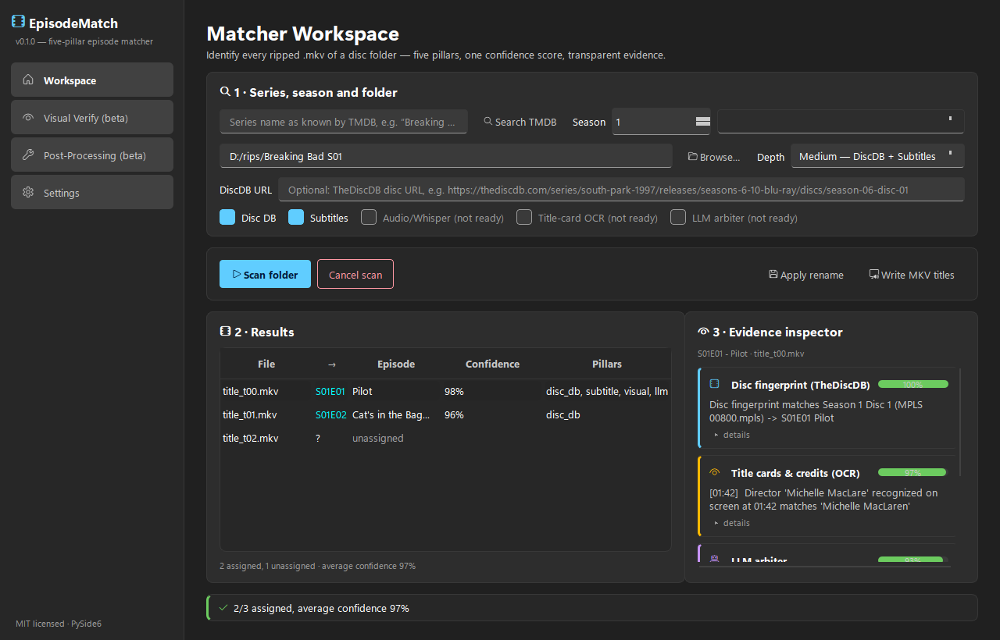
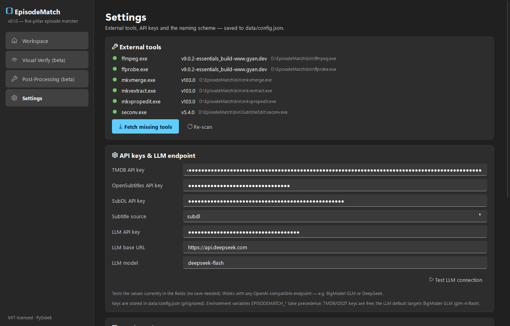

🚨 **PLEASE READ BEFORE DOWNLOADING (Early Beta & Manage Your Expectations):**
This is **v0.12.0 — an early, experimental beta**, and **I really don't want to overpromise here!** Please **only download this if you enjoy testing raw, early software and fully expect that things might fail or not work on your setup.**
* **Your mileage WILL vary:** While I had successful test runs on my own discs, a lot of the matching logic (especially the subtitle comparison) is still heavily based on theory. Just because it worked on my test rips does **not** mean you will automatically get the same results on yours!
* **USE AT YOUR OWN RISK — NO GUARANTEES:** Even though the renamer has an undo journal, **DO NOT run this on video files you don't have a backup of** (or can't easily re-rip). Always test on a backup copy first! I take zero responsibility for mangled filenames or broken MKV headers.


# EpisodeMatch

**Identify every episode in your MakeMKV rips — with evidence, not guesswork.**



EpisodeMatch is a Windows desktop tool for a very specific, very annoying problem:
when you rip a TV-season Blu-ray or DVD with MakeMKV, you get anonymous files named
after the disc's *playlists* (`title_t00.mkv`, `title_t01.mkv`, …) — and the playlist
order on the disc is almost never the episode order of the show.

EpisodeMatch tells you **which file is which episode** (`SxxExx - Episode Title`) with a
confidence score and a transparent, human-readable justification for every decision —
then renames the files into Plex/Jellyfin/Emby layout (with an undo journal), writes
episode titles into the MKV header, and optionally cleans tracks or queues the results
for AV1 encoding.

> **Status: early public beta (v0.12.0).** The **Disc DB**, **Subtitles** and
> **Title-card OCR** pillars are ready for testing and are what the tool is built around
> (the OCR pillar assigns **70–90 % of episodes** when the show displays its episode
> titles on screen).
> Everything else (Audio/Whisper, LLM arbiter, the Visual Verify and Post-Processing
> pages) is **explicitly not ready** and marked as such inside the app. See
> [Status](#status-whats-ready-and-whats-not).

| Workspace | Settings |
|---|---|
|  |  |

## Installation (Windows, Python 3.11+)

```bat
git clone https://github.com/episodematch/episodematch
cd episodematch
python -m venv .venv
.venv\Scripts\pip install -e .[gui]
```

Standalone executables (no Python needed to *run* them) can be built with
`scripts\build_exe.py` — see [Standalone executables](#standalone-executables-optional).

## Required configuration — API keys

EpisodeMatch needs **two API keys** to do its job. Both are free:

| Key | Required? | Where to get it | Env var |
|---|---|---|---|
| **TMDB** | **yes — without it nothing runs** (episode titles, plots and credits come from TMDB) | [themoviedb.org](https://www.themoviedb.org/settings/api) (free account) | `EPISODEMATCH_TMDB_API_KEY` |
| **Subtitle provider** | **yes for the Subtitles pillar** | [SubDL](https://subdl.com) (recommended) or [OpenSubtitles](https://opensubtitles.com) | `EPISODEMATCH_SUBDL_API_KEY` / `EPISODEMATCH_OSDT_API_KEY` |
| LLM | no (pillar not ready) | BigModel GLM, DeepSeek, … | `EPISODEMATCH_LLM_API_KEY` |

Keys are stored in `data/config.json` (gitignored) or set via environment variables.
All of them can be entered in the GUI's **Settings** page.

## The five pillars — what's ready and what's not

| Component | Status | What it does |
|---|---|---|
| **Disc DB** (TheDiscDB fingerprint) | ✅ **ready** | Maps every file to its episode from the disc's playlist structure |
| **Subtitles** (extract + reference matching) | ✅ **ready** | Extracts the file's subtitles, matches the dialog against reference subtitles |
| Rename / MKV tagging | ✅ **ready** | Plex-layout renaming with undo journal, `mkvpropedit` title writing |
| Audio / Whisper | 🚧 not ready | Local Whisper transcription of two audio windows |
| **Title-card OCR** | ✅ **ready** (v0.12.0) | Reads title cards / credits from keyframes and matches them against the TMDB guide — assigns **70–90 % of episodes** when the show displays its episode titles on screen |
| LLM arbiter | 🚧 not ready | Sends all evidence to an LLM for a global assignment |
| Visual Verify page | 🚧 beta | Synchronized frame comparison across all files |
| Post-Processing page | 🚧 beta | Track cleanup + SVT-AV1 encoding queue |

The two ready pillars are described in detail below — everything else is present in the
code and the UI but marked *not ready* / *beta* and should be treated as a preview.

---

## Pillar 1 — Disc DB: how the fingerprint matching works

The DiscDB pillar answers *"which physical disc is this, and which playlist on it is
which episode?"* using the community database
[TheDiscDb/data](https://github.com/TheDiscDb/data) (MIT licensed — the same source that
powers [thediscdb.com](https://thediscdb.com)).

### Step 1 — fingerprint your rip

For each `.mkv` in the folder, EpisodeMatch probes (`ffprobe` + a native EBML reader)
and collects:

- the **MakeMKV MPLS name** (e.g. `00800.mpls` — usually stored in the MKV title tag),
- the exact **duration**,
- the exact **byte size**,
- the **MakeMKV title index** from the file name (`…_t07.mkv` → title 7).

### Step 2 — load the disc data

TheDiscDB disc entries (`data/series/<Series (Year)>/<release>/discNN.json`) were created
by contributors who scanned the *exact same disc* with MakeMKV. Every title there carries
the playlist's `SourceFile` (the same MPLS name), `SegmentMap`, `Duration`, `Size` and the
episode mapping (`Season`, `Episode`, `Title`) — including extras and menus.

**Fastest way:** paste the disc URL from thediscdb.com into the GUI (or `--discdb-url`):

```
https://thediscdb.com/series/south-park-1997/releases/seasons-6-10-blu-ray/discs/season-06-disc-01
```

That loads *exactly one disc* instead of every release of a 21-season series.

### Step 3 — scoring

Every disc title is scored against your file's fingerprint:

| Signal | Weight | Why |
|---|---|---|
| MPLS name match | +0.60 | Near-conclusive — the strongest identifier |
| MakeMKV title index matches disc entry index **and the duration agrees** | +0.25 (up to +0.90 with a pinned disc URL) | The index identifies the title — but only when the runtime corroborates it |
| Duration within ±2 s — **unique on the whole disc** | **+0.70** | An individual episode runtime is near-conclusive |
| Duration within ±2 s (shared by several entries) | +0.20–0.35 | Equal-length episodes can't be told apart by runtime alone |
| Size within ±2 % | +0.10 | Weak — ripped MKVs are usually smaller than the on-disc playlist (stripped audio, container overhead) |
| Segment count match | +0.05 | Minor corroboration |

Two safety rules were learned from real discs:

- An index match **without** a matching duration is **ignored** — different MakeMKV
  versions enumerate playlists differently, so bare index collisions produced wrong
  assignments (Castle Rock S1D2: the contributor's Episode 6 sits at Index 4, the rip's
  title 6 collided with Index 6 = Episode 8).
- A duration/size coincidence below 45 % **without** an MPLS or index identifier is
  **discarded as noise** (it otherwise breeds cross-season ghost matches).

With a pinned disc URL this pillar resolves whole discs correctly even in the hard cases:
a South Park disc where MakeMKV wrote the *disc label* instead of the MPLS into the title
tag and all nine episodes are exactly 22:06 long resolved **9/9 files at 100 %** via the
title index; a Castle Rock disc with *individually different* runtimes resolved **5/5 at
80 %** purely via the unique-duration signal.

## Pillar 2 — Subtitles: how the dialog matching works

The subtitle pillar answers *"which episode's dialog does this file actually contain?"*

### Step 1 — extract the file's own subtitles

- **Text tracks** (SRT/ASS/VTT) are pulled with `mkvextract` (fallback `ffmpeg`) and
  parsed natively (override tags, hearing-impaired markers and HTML stripped).
- **Blu-ray PGS tracks** (image subtitles) are dumped as `.sup` and converted:
  1. **seconv fast path** (recommended, auto-downloadable): SubtitleEdit's headless
     converter OCRs the *full* track with its nOCR engine, unattended.
  2. **Native Python fallback**: a complete PGS binary parser (segment container,
     PCS/WDS/PDS/ODS reassembly, RLE decoding, BT.601/709 palettes) decodes the bitmaps
     and local OCR reads them — strictly capped at the first 40 events, never a whole
     film in Python.

### Step 2 — fetch a reference subtitle per candidate episode

The reference is requested **in the same language as the extracted track** (a German
track is matched against German dialog; ISO 639-2 tags like `ger` are converted to the
API forms). Cross-language fallbacks are deliberately not attempted — they would be
discarded by the language guard and only burn download quota.

Two sources are built in and selectable in **Settings → Subtitle source**:

| Source | Free tier | Recommendation |
|---|---|---|
| [OpenSubtitles](https://opensubtitles.com) | **5 downloads / 24 h** | Precise API — but the download cap makes it impractical for whole seasons |
| [SubDL](https://subdl.com) | **2,000 requests + 300 downloads / day** | **Recommended** — serves ZIP archives with SRTs, extracted automatically; cached locally for 14 days |

SubDL candidates are validated against the request (ISO language code, season, and the
episode field or `episode_from`/`episode_end` range) — whole-season subtitle packs are
used automatically when no per-episode SRT exists, so US/international shows work even
when only season packs are indexed. Transient SubDL rate-limit responses (429
"service_busy") are retried automatically.

> **Note:** PGS→text conversion is a *matching* step only — on a Blu-ray the PGS track
> itself stays untouched in your file (authored at 1080p, it survives upscaling better
> than regenerated text). Converting image subtitles to text is a genuine improvement
> mainly for DVD/VobSub sources.

### Step 3 — coverage-based dialog scoring

For each candidate episode, EpisodeMatch counts how many **distinct reference lines** of
that episode's subtitle are confirmed (fuzzy ≥ 80) by at least one extracted line,
relative to the reference's full unique line count:

- the **true episode confirms ~100 % of its own reference dialog**,
- wrong episodes only accumulate generic collisions and recap lines (~9–20 %),
- **conclusive coverage floor**: ≥ 85 % reference coverage sets a confidence floor of
  0.93 — the extracted dialog literally matches the episode's subtitle.

The similarity matrix is computed with `rapidfuzz.process.cdist` (C++, parallel) — a
full film against a full reference stays fast. Everything is reported as evidence
(`"S01E04: 67 % text match … 100 % reference dialog covered"`) and feeds the solver.

### Step 4 — the solver

All evidence is combined per (file, episode); a Hungarian-algorithm assignment
(`scipy.optimize.linear_sum_assignment`) distributes episodes globally so **no episode is
assigned twice**. Assignments below the confidence threshold are reported as *unassigned*
with their best guess instead of being guessed silently.

## Pillar 4 — Title-card OCR: how the frame matching works

The title-card pillar answers *"what does the video itself say about this episode?"*
Many shows print the **episode title on screen** (a title card right after the opening,
typically around the end of the first chapter), and the credit rolls name **directors,
writers and guest stars**. Both are read from keyframes and matched against the TMDB
season guide.

> **The one requirement:** the episode title must actually be **displayed on screen**.
> Shows that use title cards (most pre-2000 DVD productions, …) get the full benefit —
> in tests the pillar assigns **70–90 % of episodes on its own** (9/11 files resolved
> from title cards alone, no DiscDB entry, no subtitle references). If a show never
> displays its episode titles, pillar 4 cannot discriminate the episodes by title — it
> can still corroborate through credit names (director/writer/guest matches) and
> confirm the series choice via main-cast cards, but a title-less show relies on the
> DiscDB and Subtitle pillars.

### What is scanned

- **Title window** (first minutes of the file): a 2.5 s probe grid — **densified to
  1 s steps in ±10 s zones around every MKV chapter mark**, because the title card
  typically sits right around the end of the first chapter. Scene cuts are always
  probed as well; the title window is never frame-capped, so a slow fade-in title
  is not lost.
- **Credits tail**: uniformly sampled across the rolling credits (the end credits
  name this episode's directors, writers and guest stars).

### Reading the frames

- **Dual OCR backends**: the OCR built into Windows (WinRT) plus
  [RapidOCR](https://github.com/RapidAI/RapidOCR) as the second engine — selectable
  via `extraction.ocr_backend` in the config. RapidOCR reads stylized/title fonts
  noticeably better (0.92–0.99 confidence where WinRT
  misread them).
- **Grayscale retry**: a frame that reads empty or noise-only is re-OCRed on a
  grayscale-contrast variant before it is given up on.

### Matching against the guide

- **Episode title vs card text**: normalized fuzzy match with four guards learned
  from real discs — the series logo on every card is filtered out (it partial-matches
  title-like episode names), next-episode teaser cards in the credit tail are ignored,
  short titles need a near-exact full-line match, and OCR spacing quirks are
  normalized (`"THE37's` and `The 37's` both normalize to the same text).
- **On-screen names vs TMDB credits**: directors, writers and guest stars are matched
  fuzzily; a name credited in *many* season episodes fades via a normalized season-IDF
  so showrunners credited everywhere cannot dominate the score.
- **Series-cast hints**: a main-cast name on a card (prints only last names like —
  "PICARDO") confirms the series choice as evidence, without contributing episode
  score.
- Every hit becomes timestamped evidence (`Title card 'PROTOTYPE' matches episode
  title (100 %)`), so every assignment stays auditable in the evidence inspector.

## Step-by-step usage

### GUI

1. **Workspace** → enter the series name → *Search TMDB* → pick the show, set the season.
2. Enter the rip folder (or *Browse…*), optionally paste the **TheDiscDB disc URL**.
3. Pick the depth preset: **Fast — DiscDB only**, **Medium — DiscDB + Subtitles**
   (recommended), **Deep — all five pillars**.
4. *Scan folder* → inspect the results table and the evidence inspector.
5. *Apply rename* (with undo journal) and/or *Write MKV titles*.

### CLI

```bat
:: recommended: fingerprint + subtitles, pinned to the exact disc
episodematch match "D:\Rips\SP S06D1" --series "South Park" --season 6 ^
    --discdb-url "https://thediscdb.com/series/south-park-1997/releases/seasons-6-10-blu-ray/discs/season-06-disc-01"

:: machine-readable output / apply renamer / write MKV titles
episodematch match "D:\Rips\Show S01" --series "Great Show" --season 1 --json --rename --tag

:: environment check: tools, OCR backend, API keys
episodematch check-env
```

## Configuration reference

Everything lives in `data/config.json` (created on first save from the Settings page);
environment variables take precedence:

| Setting | Config key | Env var | Default |
|---|---|---|---|
| TMDB API key | `tmdb_api_key` | `EPISODEMATCH_TMDB_API_KEY` | — (**required**) |
| OpenSubtitles API key | `opensubtitles_api_key` | `EPISODEMATCH_OSDT_API_KEY` | — |
| SubDL API key | `subdl_api_key` | `EPISODEMATCH_SUBDL_API_KEY` | — |
| Subtitle source | `subtitle_source` | `EPISODEMATCH_SUBTITLE_SOURCE` | `opensubtitles` (`subdl` recommended) |
| LLM API key / base URL / model | `llm_*` | `EPISODEMATCH_LLM_*` | BigModel GLM `glm-4-flash` |
| Preferred subtitle languages | `preferred_languages` | — | `["ger", "deu", "eng"]` |
| Naming template | `naming.episode_template` | — | `{series}/Season {season:02d}/…` |
| AV1 preset / CRF | `av1_preset`, `av1_crf` | — | `6` / `30` |

## External tools

EpisodeMatch needs `ffmpeg.exe`, `ffprobe.exe`, `mkvmerge.exe`, `mkvextract.exe`,
`mkvpropedit.exe` and (for the PGS fast path) `seconv.exe`. They are searched in the
local `./bin/` folder, the system `PATH` and `C:\Program Files\MKVToolNix\` — and
downloaded automatically by `episodematch fetch-tools` (ffmpeg from gyan.dev, MKVToolNix
from mkvtoolnix.download, SeConv from the SubtitleEdit GitHub releases).

## Standalone executables (optional)

```bat
.venv\Scripts\pip install -e .[gui,pack]
.venv\Scripts\python scripts\build_exe.py --smoke
```

* `dist\cli\episodematch\episodematch.exe` — console CLI
* `dist\gui\EpisodeMatch\EpisodeMatch.exe` — the windowed Windows-11 GUI

Run them from a directory that contains `./bin/` and `./data/` (typically the project
root). Each bundle is ~255 MB. Prebuilt archives ship on the GitHub Releases page as
**two separate ZIPs** — one for the CLI, one for the GUI — each with the license texts
included (the GPL tools themselves are fetched by `episodematch fetch-tools` on your
machine, keeping the archives GPL-clean).

## Status: what's ready and what's not

This is the **early public beta (v0.12.0)**. Pillars 1, 2 and 4 are ready for testing and
were validated against real rips (DVD test sets: **9/11 files assigned from title cards
alone** — no DiscDB entry, no subtitle references — plus stylized title fonts calibrated).
For shows that display their episode titles, the title-card pillar assigns
**70–90 % of episodes on its own**; shows that never display titles rely on the DiscDB
and Subtitle pillars.
Everything else is present but
**not ready**: Audio/Whisper and the LLM arbiter are marked *not ready*
in the pillar checkboxes; the Visual Verify and Post-Processing pages are marked *beta*
and show an in-page warning banner. Treat them as previews — do not rely on their
results.

## Development

```bat
.venv\Scripts\pip install -e .[dev]
.venv\Scripts\python -m pytest tests\
```


## Acknowledgments & Attribution

* **TMDB:** This product uses the TMDB API but is not endorsed or certified by TMDB. Free TMDB API keys are licensed for non-commercial use only.
* **TheDiscDB:** Disc fingerprint data is powered by the community project [TheDiscDb/data](https://github.com/TheDiscDb/data) (MIT License).
* **Subtitles:** Reference subtitle matching is supported via [SubDL](https://subdl.com) and [OpenSubtitles](https://opensubtitles.com) (users must provide their own personal API keys and abide by the respective provider's terms of service and daily rate limits).

## Antivirus false positives

A few ML/heuristic-based engines (e.g. Arctic Wolf, Bkav Pro, SecureAge, Skyhigh) may flag the unsigned PyInstaller-built executables generically — a well-known false-positive pattern for this file type; signature-based engines (Microsoft Defender, Kaspersky, ESET, Bitdefender, …) detect nothing. Verify before running: compare the executable's SHA-256 against the hash published in the release notes, or build the executables yourself from this source.

---

# EpisodeMatch (Deutsche Kurzfassung)

**Erkenne jede Episode in deinen MakeMKV-Rips — mit Belegen statt Ratesen.**

EpisodeMatch löst ein konkretes Problem: Beim Rippen einer Serien-Blu-ray/-DVD mit
MakeMKV entstehen anonyme Dateien (`title_t00.mkv`, …), deren Reihenfolge auf der Disc
fast nie der Episoden-Reihenfolge entspricht. EpisodeMatch ordnet jede Datei der exakten
Folge (`SxxExx - Episodentitel`) zu — mit Confidence-Score und nachvollziehbarer
Begründung — und benennt sie anschließend Plex/Jellyfin/Emby-gerecht um (mit
Undo-Journal), schreibt den Episodentitel per `mkvpropedit` in den MKV-Header und kann
optional Spuren bereinigen oder für AV1-Encoding in eine Warteschlange stellen.

> **Status: frühe öffentliche Beta (v0.12.0).** Die Säulen **Disc DB**, **Subtitles** und
> **Title-card OCR** sind bereit für Tests — die OCR-Säule ordnet **70–90 % der Folgen**
> zu, wenn die Serie ihre Episodentitel einblendet. Alles andere (Audio/Whisper, LLM arbiter, die
> Seiten Visual Verify und Post-Processing) ist **bewusst noch nicht fertig** und ist im
> Programm entsprechend markiert.

## Benötigte API-Keys (beide kostenlos)

| Key | Pflicht | Bezug |
|---|---|---|
| **TMDB** | **Ja — ohne geht nichts** (Episodentitel, Plots, Credits) | [themoviedb.org](https://www.themoviedb.org/settings/api) |
| **Untertitel-Quelle** | **Ja für die Subtitles-Säule** | [SubDL](https://subdl.com) (empfohlen) oder [OpenSubtitles](https://opensubtitles.com) |
| LLM | Nein (Säule noch nicht fertig) | BigModel GLM, DeepSeek, … |

Die Keys gehören in `data/config.json` oder als Umgebungsvariablen
(`EPISODEMATCH_TMDB_API_KEY`, `EPISODEMATCH_SUBDL_API_KEY`, `EPISODEMATCH_OSDT_API_KEY`,
`EPISODEMATCH_LLM_API_KEY`, …) — beides kann in der GUI unter **Settings** eingetragen
werden.

## Säule 1 — Disc DB (Fingerprint-Abgleich gegen TheDiscDB)

Die Community-Datenbank [TheDiscDb/data](https://github.com/TheDiscDb/data) (MIT) enthält
pro Disc die Playlist-Struktur: **SourceFile** (MPLS-Name), **SegmentMap**, **Duration**,
**Size** und die Zuordnung **Titel → Episode** — geschrieben von Leuten, die dieselbe
Disc mit MakeMKV gescannt haben.

1. **Fingerprint:** Für jede MKV sammelt EpisodeMatch MPLS-Name (aus dem Title-Tag),
   exakte Dauer, exakte Größe und den **MakeMKV-Titel-Index** aus dem Dateinamen
   (`…_t07.mkv` → 7).
2. **Disc laden:** Am schnellsten per **Disc-URL** aus thediscdb.com (GUI-Feld oder
   `--discdb-url`) — dann wird genau **eine Disc** geladen statt aller Releases einer
   Serie.
3. **Scoring:** MPLS-Match +0.60; Titel-Index-Match **nur mit bestätigter Dauer** +0.25
   (mit Disc-URL +0.90); **eindeutige Dauer auf der ganzen Disc +0.70**; Dauer (mehrfach
   vorhanden) +0.20–0.35; Größe +0.10 (schwach — gerippte MKVs sind kleiner als die
   Disc-Playlist); Index-Kollisionen **ohne** passende Dauer werden ignoriert
   (unterschiedliche MakeMKV-Versionen nummerieren Playlists anders — otherwise falsche
   Zuordnungen).

Live-verifiziert: South Park S6D1 — MakeMKV schrieb den Disc-Namen statt der MPLS in den
Title-Tag und alle 9 Episoden sind exakt 22:06 lang → **9/9 korrekt @ 100 %** über den
Titel-Index. Castle Rock S1D2 — individuell unterschiedliche Laufzeiten, Contributor
nummerierte die Playlists anders → **5/5 korrekt @ 80 %** über die eindeutige Dauer.

## Säule 2 — Subtitles (Extraktion + Dialog-Abgleich)

1. **Extraktion:** Text-Spuren (SRT/ASS/VTT) per `mkvextract`/ffmpeg mit nativen
   Parsers. **PGS-Bilduntertitel** werden als `.sup` gedumpt und über
   **seconv.exe** (SubtitleEdits headless Konverter, nOCR-Engine, wird automatisch
   geladen) in SRT konvertiert — vollautomatisch. Fallback: nativer Python-PGS-Parser
   + lokale OCR, begrenzt auf die ersten 40 Untertitel-Events.
2. **Referenz in der richtigen Sprache:** Die Referenz wird **in der Sprache der
   extrahierten Spur** angefragt (`ger` → deutsche Referenz) — bei OpenSubtitles oder
   **SubDL (empfohlen: 2.000 Requests + 300 Downloads/Tag statt 5/24h)**. Referenzen
   werden lokal gecacht (Rescans verbrauchen kein Kontingent). SubDL-Kandidaten werden
   gegen die Anfrage validiert (ISO-Sprachcode, Staffel, Episoden-Feld bzw.
   `episode_from`/`episode_end`-Bereich) — wenn keine Einzel-Episoden-SRT verfügbar
   ist, werden automatisch Staffel-Pakete genutzt; flüchtige 429-Antworten
   („service_busy") werden automatisch wiederholt.
3. **Coverage-Scoring:** Es wird gezählt, wie viele **eindeutige Referenzzeilen** der
   Kandidaten-Episode durch die Extraktion bestätigt werden (Fuzzy ≥ 80). Die richtige
   Episode deckt ~100 % ihrer eigenen Referenz ab; falsche nur ~9–20 % (Generika +
   Recaps). Ab **85 % Coverage** greift eine Confidence-Untergrenze von 0.93.
4. **Solver:** Ein Ungarisches Verfahren (`scipy`) verteilt die Episoden global — keine
   Episode wird doppelt vergeben; alles unter der Confidence-Schwelle wird ehrlich als
   *unassigned* mit Best-Guess gemeldet.

## Säule 4 — Title-card OCR (neu in v0.12.0)

Viele Serien blenden den **Episodentitel auf dem Bildschirm** ein (Title-Card nach dem
Opening, typischerweise um das Ende des ersten Kapitels), und der Abspann nennt
**Regisseure, Autoren und Gaststars** — beides wird aus Keyframes gelesen und gegen den
TMDB-Staffel-Guide gematcht.

> **Die eine Voraussetzung:** der Episodentitel muss **auf dem Bildschirm erscheinen**.
> Serien mit Title-Cards (die meisten DVD-Produktionen vor 2000, …) bekommen den vollen Nutzen — live ordnet die Säule
> **70–90 % der Folgen allein** zu (in Tests 9/11 Dateien aus Title-Cards allein,
> ohne DiscDB-Eintrag und ohne Untertitel-Referenzen). Serien, die ihre Titel nie
> einblenden, können über diese Säule nicht nach Episoden unterschieden werden — sie
> bestätigt dann nur die Serie (Hauptcast-Cards) und liefert schwache Credit-Hinweise;
> solche Shows verlassen sich auf die DiscDB- und Subtitles-Säulen.

Im Detail: Probe-Raster im Titel-Fenster (2,5-s-Raster, in ±10-s-Zonen um jede
MKV-Kapitelmarke auf 1 s verdichtet), gleichmäßiges Sampling im Abspann; zwei
OCR-Backends (Windows-WinRT + RapidOCR, wählbar; RapidOCR liest stilisierte Fonts
deutlich besser) mit Graustufen-Retry bei leeren Frames; Titel-Abgleich mit vier Guards
aus echten Discs (Serienlogo-Filter, Teaser-Card-Filter im Abspann, Kurz-Titel-Schutz,
OCR-Abstands-Normalisierung); Credit-Namen mit Staffel-IDF (in vielen Folgen
Genannte verblassen); Serien-Cast-Hinweise als Evidence ohne Episoden-Score. Jeder
Treffer wird mit Timestamp als Evidence protokolliert.

## Schritt für Schritt (GUI)

1. **Workspace** → Seriennamen eingeben → *Search TMDB* → Serie wählen, Staffel setzen.
2. Rip-Ordner wählen, optional die **TheDiscDB-Disc-URL** einfügen.
3. Depth wählen: **Fast** (nur DiscDB), **Medium** (DiscDB + Subtitles, empfohlen),
   **Deep** (alle Säulen).
4. *Scan folder* → Ergebnisse prüfen (Confidence-Balken + Evidence-Inspector mit
   Begründungen).
5. *Apply rename* (mit Undo-Journal) und/oder *Write MKV titles*.

## Was noch nicht fertig ist

🚧 **Audio/Whisper** und 🚧 **LLM arbiter** (in den Checkboxen als *not ready* markiert)
sowie die Seiten 🚧 **Visual Verify** und 🚧 **Post-Processing** (*beta* in der Navigation
+ Warnbanner). Vorhanden, aber als Vorschau behandeln — bitte nicht auf ihre Ergebnisse
verlassen. ✅ **Title-card OCR** ist seit v0.12.0 reif für weitere Tests.

## Installation & Tools

```bat
git clone https://github.com/episodematch/episodematch
cd episodematch
python -m venv .venv
.venv\Scripts\pip install -e .[gui]
episodematch check-env       :: Tool-Status, OCR-Backend, API-Keys
episodematch fetch-tools     :: lädt ffmpeg + MKVToolNix + SeConv nach .\bin\
```

Benötigt wird: `ffmpeg.exe`, `ffprobe.exe`, `mkvmerge.exe`, `mkvextract.exe`,
`mkvpropedit.exe` und `seconv.exe` — gesucht in `./bin/`, im PATH und unter
`C:\Program Files\MKVToolNix\`, fehlende werden automatisch geladen.

Fertige EXEs (ohne Python-Installation lauffähig):

```bat
.venv\Scripts\pip install -e .[gui,pack]
.venv\Scripts\python scripts\build_exe.py --smoke
```

* `dist\cli\episodematch\episodematch.exe` — Konsole-CLI
* `dist\gui\EpisodeMatch\EpisodeMatch.exe` — Windows-11-GUI

Fertige Archive gibt es auf der GitHub-Releases-Seite als **zwei separate ZIPs** (CLI und
GUI), jeweils mit Lizenztexten — die GPL-Tools lädt `episodematch fetch-tools` selbst
nach, damit die Archive GPL-frei bleiben.

## Lizenz

MIT — siehe [LICENSE](LICENSE).

## Antivirus-Falschmeldungen

Einige ML-/heuristikbasierte Engines (z. B. Arctic Wolf, Bkav Pro, SecureAge, Skyhigh) können die unsignierten PyInstaller-EXEs generisch markieren — ein bekanntes Falsch-Positiv-Muster dieses Dateityps; die großen Signature-Engines (Microsoft Defender, Kaspersky, ESET, Bitdefender, …) melden nichts. Vor dem Ausführen prüfen: SHA-256 der EXE mit dem im Release angegebenen Hash vergleichen oder die EXEs selbst aus diesem Quellcode bauen.
